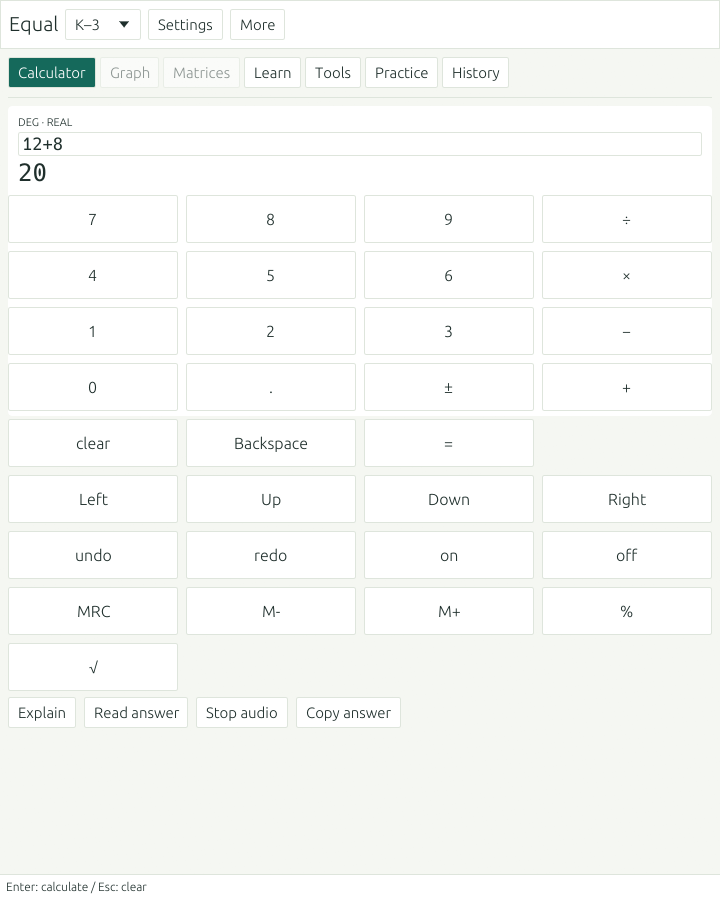
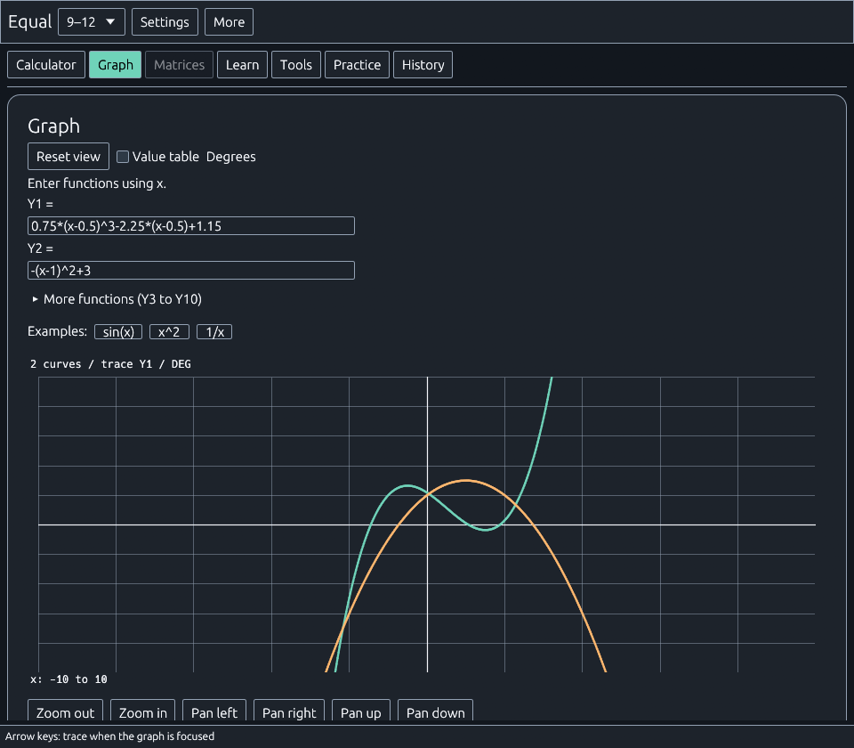
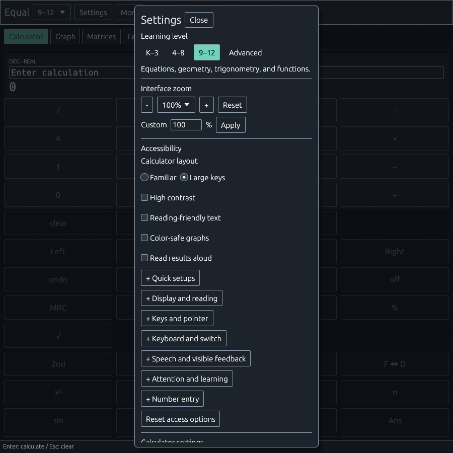

<p align="center">
  
</p>

<p align="center">
  
  
  
  
  <a href="LICENSE"></a>
</p>

<p align="center">
  <a href="#get-started">Get started</a> ·
  <a href="#what-you-can-do">Features</a> ·
  <a href="#accessibility">Accessibility</a> ·
  <a href="#learning-and-practice">Learning</a> ·
  <a href="#development">Development</a>
</p>

# Equal

A native desktop calculator with graphing, worked lessons and practice from K–3 through advanced mathematics. Use it beside online homework in a narrow window, or open the larger workspace for graphs, matrices and lessons.

The core calculator, practice questions and built-in explanations run locally. No account, subscription or AI model is required.

<p align="center">
  
</p>

## What you can do

| Workspace | Included |
| --- | --- |
| **Calculator** | Grade-specific handheld layouts or a large-key view; real and complex arithmetic; fractions; scientific functions; A–Z variables; Ans; undo and redo |
| **Graph** | Ten function slots, an on-calculator graph, a larger optional view, keyboard trace, tables, CSV, numerical analysis and coordinate drawings |
| **Data and programs** | Six named lists, statistics, closed-form sequences and a bounded local calculator-language interpreter |
| **Matrices** | Matrix operations, determinants and linear systems |
| **Learn** | Worked arithmetic, equations, polynomial derivatives and definite integrals; hints, vocabulary and answer checks |
| **Practice** | 25 topics with Basic, Standard and Challenge questions, visual models and worked solutions |
| **Tools** | 30 tools covering statistics, probability, fractions, algebra, conversions, percentages, finance and geometry |

The familiar layouts are TI-108-inspired for K–3, TI-34-inspired for 4–8, and TI-84-style for both 9–12 and Advanced. Their casing, keys and live display are drawn in the app. Equal is an independent implementation; these layouts do not establish TI firmware compatibility.

### Graphing stays on the calculator

**Y=**, **WINDOW**, **ZOOM**, **TRACE** and **GRAPH** operate the calculator's display. **2nd → GRAPH** opens its table. The **Graph** tab opens a larger view of the same functions.

Numerical tools find values, zeros, intersections, extrema, derivatives and integrals within selected bounds. Points, lines and circles use editable coordinates, with undo. Text descriptions, coordinates and tables provide alternatives to the plotted curves; optional pitch playback represents sampled graph values.

Graphs, tables and tracing follow the selected Degrees/Radians setting. MATLAB export sends numeric samples from Y1 and Y2 to a separately installed MATLAB. Numerical results are approximations and can miss features between samples.

<p align="center">
  
</p>

### Editing, lists and programs

Use scientific exponent entry, alpha lock, named variables, selection-aware editing and undo/redo. L1–L6 hold up to 1,000 finite real values each. Sequences u/v/w use closed formulas in integer `n`; recurrence formulas are not implemented.

**PRGM** supports a local TI-BASIC-style subset: assignments, `Disp`, resumable `Input` and `Pause`, conditionals, loops, labels and stop commands. Execution and output are bounded. It does not implement every TI command or execute host programs.

**2nd → x,t** opens Equal text transfer for variables, lists, sequences, graph functions and programs. Import validates the complete JSON packet and can be undone. This format does not communicate with physical TI hardware. See [calculator workflows and limits](docs/notes/calculator-accessibility.md).

## Accessibility

Choose **Settings** to combine individual controls or start with **Large print**, **Large targets**, **Reading support**, **Low distraction** or **Quiet**. Presets preserve your calculation, learning level and angle mode. No diagnosis or demographic profile is requested.

| Need or preference | Available controls |
| --- | --- |
| **Larger, clearer presentation** | 90–400% interface zoom, exact intermediate percentages, independent body-text size and spacing, Light/Warm/Dark themes, stronger contrast and reading-friendly text |
| **Pointer and motor access** | Large-key calculator with 40–80 point targets, adjustable gaps, word labels, left-handed operators, activation guard and optional pointer dwell |
| **Keyboard and switch access** | Named native controls, visible focus, keypad arrow navigation, editing shortcuts, and opt-in row/key scanning using Space |
| **Reading and attention** | Reading guide, 50-entry searchable math glossary, one-step explanations, focus mode, optional help and hidden scores |
| **Speech and hearing preferences** | Optional local Windows speech, voice/rate/volume controls, spoken keypad labels/focus, visible announcements, quiet setup and Stop audio |
| **Graphs without relying on color** | Curve names and patterns, text summaries, keyboard trace, coordinates, editable tables and optional graph sound |
| **Number conventions** | Supported non-Latin decimal digits and decimal-comma input; semicolons separate arguments and multiple answers in comma mode |

<p align="center">
  
</p>

Dwell and switch scanning apply to the **calculator keypad**. Dwell requires a deliberate hold and leaving the key before repeating. Scanning starts paused; Space selects a row, then a key. Dialogs pause scanning, and returning requires a deliberate restart. Settings and other workspaces still need ordinary keyboard/pointer navigation or operating-system assistive tools.

Actual screen-reader, Braille, switch, eye-tracker, magnifier and disabled-learner compatibility remains unverified. The interface is English; numeric digit support does not establish translation or RTL support. The in-app assistive-technology checklist records tasks actually tried and keeps untried tasks marked **Not tested**. See the [inclusive-design acceptance matrix](docs/notes/inclusive-design.md).

### Useful shortcuts

| Shortcut | Action |
| --- | --- |
| **F1** | Keyboard help |
| **Ctrl+,** | Settings |
| **Ctrl+G** | Math glossary |
| **Ctrl+H** | Calculation history |
| **Ctrl+Shift+Space** | Stop speech and graph audio |
| **Alt+1…6** | Calculator, Graph, Matrices, Learn, Tools and Practice, where the selected level permits |
| **Ctrl+Z / Ctrl+Y** | Undo/redo calculator editing when a text field is not focused |
| **Alt+Up / Alt+Down** | Enable and move the reading guide |

Text fields retain their normal editing and clipboard shortcuts. **Tab** and **Shift+Tab** move focus; **Space** activates a focused button.

## Learning and practice

Built-in lessons and practice are generated locally without AI. Questions include hints, worked steps, answer checks and text equivalents for visual models.

| Level | Practice topics |
| --- | --- |
| **K–3** | Addition, subtraction, counting/comparing, place value, number lines, missing numbers |
| **4–8** | Multiplication, division, fractions, decimals, percentages, ratios/proportions, order of operations |
| **9–12** | Linear equations, quadratics, geometry, coordinate geometry, trigonometry, functions |
| **Advanced** | Derivatives, definite integrals, limits, matrix operations, determinants, linear systems |

Answers accept equivalent fractions and constant expressions such as `sqrt(2)`. Multiple answers can be given in either order where appropriate. Trigonometry questions state their units; trig expressions entered as practice answers use radians. Rounding requirements appear in the question.

Scores track first attempts separately by topic and difficulty. Repeated checks do not inflate progress; revealing an unanswered solution counts as an attempt. Scores can be hidden without removing feedback. Progress currently lasts for the app session; saved notebooks and persistent progress are planned. [Practice details](docs/notes/practice-learning.md) explain the scoring and conventions.

For a worked lesson, choose **Learn** or **Explain**, type a problem, or upload/drag in a UTF-8 TXT file. The local solver covers arithmetic, linear/quadratic equations and polynomial calculus through degree 8. Try `2*x + 3 = 11`, `diff(x^3, 2)` or `integral(x^2, 0, 3)`.

<details>
<summary><strong>Optional local Ollama tutor</strong></summary>

The **Local AI** section can use a model you have already installed in [Ollama](https://ollama.com), running at `127.0.0.1:11434`. Equal does not install models or require an API key. Use a local model rather than a cloud model.

An installed vision model can transcribe an uploaded PNG/JPG problem. Review and correct the transcription before requesting an explanation. Uploads are limited to 8 MB; text problems to 8,000 characters. AI explanations and follow-ups are labeled as AI output and may contain mathematical errors. Built-in lessons remain available without Ollama.

Uploaded content and conversations stay in session memory and are not saved as preferences. Equal sends these requests to loopback without a proxy. A live model has not been validated; serialization, parsing, error paths and HTTP transport with a local mock server have tests. The integration uses Ollama's [chat](https://docs.ollama.com/api/chat) and [vision](https://docs.ollama.com/capabilities/vision) interfaces.

</details>

## Get started

Equal is under active development. Build from source with a current [Rust toolchain](https://www.rust-lang.org/tools/install) supporting edition 2024. Windows is the tested platform; other desktop platforms are not yet verified.

From the repository root:

```sh
cargo run --release
```

The first build downloads Rust dependencies. Once dependencies are available locally, the core app works offline. Windows speech uses the installed Windows voice service.

Choose a learning level in **Settings**. Use **Workspace** for the full navigation, or **More → Handheld view** for the compact calculator. Narrow windows use a scrolling Settings dialog; wide windows can show a sidebar. Changing views does not resize the window.

To open a specific practice view on Windows:

```powershell
./target/release/equal-calculator.exe --practice --level 4-8 --topic fractions --difficulty standard --size 800x900
```

Add `--show-solution` to preview a worked solution. Start the large-key view with `--layout accessible`, or select it in Settings.

## Development

The app uses Rust, [eframe/egui](https://github.com/emilk/egui), serde and the image crate. Calculator, graphing and lesson behavior live under `src/`; implementation notes and acceptance tasks are in [`docs/notes/`](docs/notes/).

Run checks locally:

```sh
cargo fmt --all -- --check
cargo test
cargo clippy --all-targets -- -D warnings
cargo build --release
```

If Windows locks existing build artifacts, choose an isolated target directory and use it consistently across commands:

```powershell
cargo test --target-dir "$env:TEMP/equal-build"
cargo clippy --all-targets --target-dir "$env:TEMP/equal-build" -- -D warnings
cargo build --target-dir "$env:TEMP/equal-build"
```

Capture an app screenshot without external screen-capture software:

```powershell
./target/debug/equal-calculator.exe --screenshot shots/current.png --size 800x900 --workspace --layout accessible
```

Other preview options include `--preview graph`, `--preview tutor`, `--preview settings`, `--contrast`, `--readable`, `--theme dark` and `--scale 1.25`.

Contributions can focus on calculator behavior, local tests, plain-language explanations and accessibility. For bugs, include the learning level, window size, relevant settings, steps to reproduce and expected result. For assistive-technology reports, include the tool/OS versions and task tried; do not include private homework, diagnoses or personal information. Keep changes focused and run the relevant local checks.

See [contributing](CONTRIBUTING.md), [security reporting](SECURITY.md), and the [dependency advisory review](docs/notes/dependency-review.md). The current lockfile has four informational maintenance advisories; ongoing dependency review is part of development.

## License and acknowledgements

Equal's original source and original artwork are released under the [MIT license](LICENSE). Third-party dependencies retain their own licenses; see [third-party notices](THIRD_PARTY_NOTICES.md).

Texas Instruments product names and any optional locally supplied reference photographs belong to their respective owners. Reference photographs are not covered by Equal's MIT license and are not required to build the public source. Equal is not affiliated with or endorsed by Texas Instruments or MathWorks. MATLAB requires a separate installation and license.

[Calculator and accessibility notes](docs/notes/calculator-accessibility.md) · [Practice implementation](docs/notes/practice-learning.md) · [Research and conventions](docs/notes/feature-research.md)
